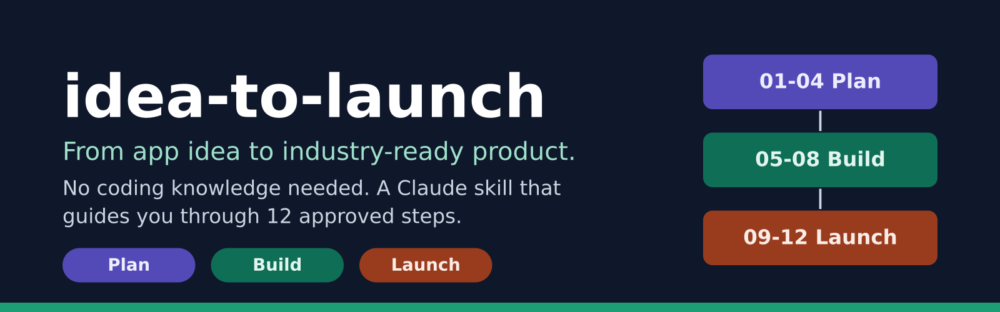
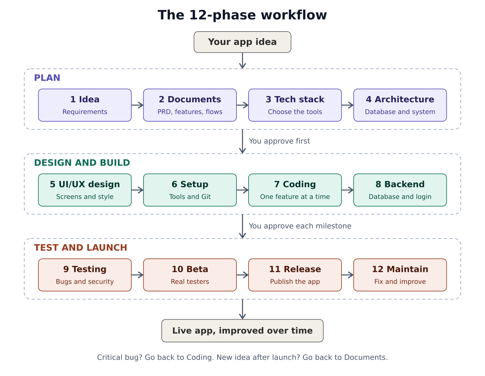
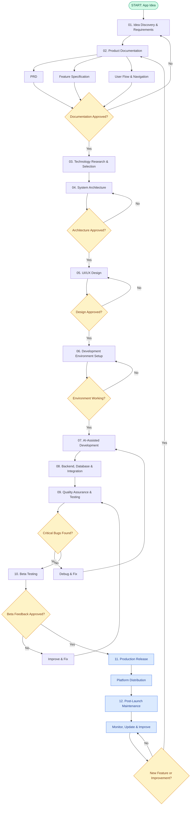
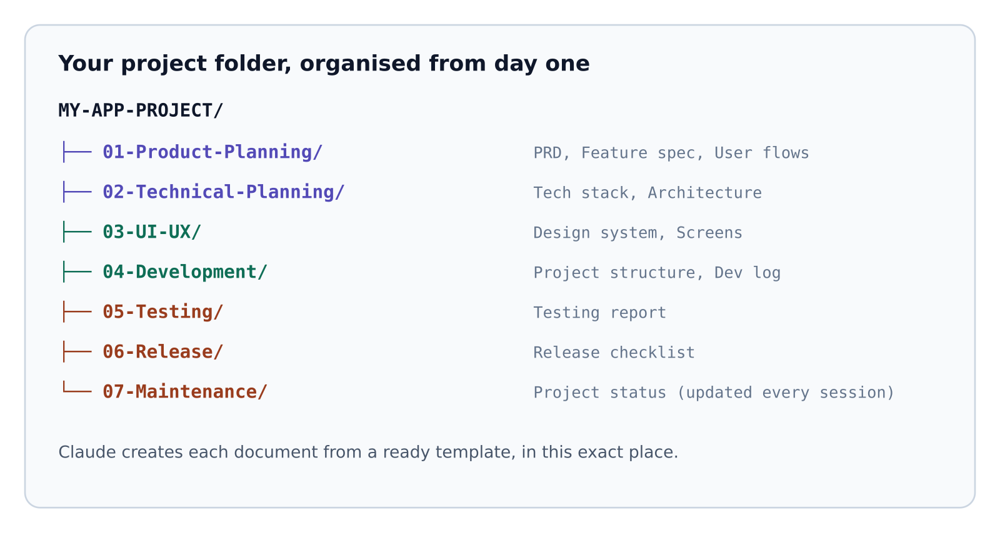

<p align="center">
  
</p>

# idea-to-launch

A Claude skill that guides **non-technical people** from an app idea to an industry-ready launch, in a proper structure.

You do not need to know how to code. You are the product owner. Claude acts as your technical co-founder and walks you through **12 steps**. **A step never starts until you approve the one before it.**

## What it does

- Asks you about your idea, one simple question at a time.
- Writes the planning documents for you (PRD, feature list, user flows).
- Helps you choose the right technology, and explains each choice in simple words.
- Plans the system, designs the screens, sets up the tools.
- Builds the app one small feature at a time, and tests each one.
- Prepares beta testing, release and long-term maintenance.
- Replies in the language you write in (English or Bangla).

## The 12-phase workflow

<p align="center">
  
</p>

| Group | Phases |
|---|---|
| Plan | 1 Idea, 2 Documents, 3 Tech stack, 4 Architecture |
| Design and build | 5 UI/UX design, 6 Setup, 7 Coding, 8 Backend |
| Test and launch | 9 Testing, 10 Beta, 11 Release, 12 Maintain |

## Detailed flow with approval gates

Every diamond is a gate. If the answer is "No", the work goes back and is fixed. Claude does not move forward.

<p align="center">
  
</p>

## Organised project folder

Claude keeps every document in the same place, from day one.

<p align="center">
  
</p>

Each document is created from a ready template inside the skill, so every project looks the same and nothing is forgotten.

## How to install

**Claude Code**

```bash
git clone https://github.com/neerhasan/idea-to-launch ~/.claude/skills/idea-to-launch
```

**Claude app (claude.ai)**

1. Download this repo as a ZIP (Code button, then Download ZIP).
2. Open Claude, go to Settings, then Capabilities, then Skills.
3. Upload the ZIP.

The exact menu names can change. If you cannot find Skills, check Claude's help pages for the current steps.

## How to use

Start a new chat and write something like:

> I have an app idea. Use the idea-to-launch skill and guide me.

Claude introduces itself and asks you to describe your idea. From there, just answer one question at a time and approve each step when you are happy.

## Rules the skill follows

1. No coding before the planning, architecture and design are approved.
2. One question at a time. Technical words are always explained.
3. You approve every major step. Silence is not approval.
4. Build one feature at a time. Test before moving on.
5. Nothing is called "done" or "published" until it is really done and checked.
6. No secrets or API keys in code that users can see.

## Contributing

Ideas and fixes are welcome. Open an issue or a pull request.

## License

MIT. See [LICENSE](LICENSE).
